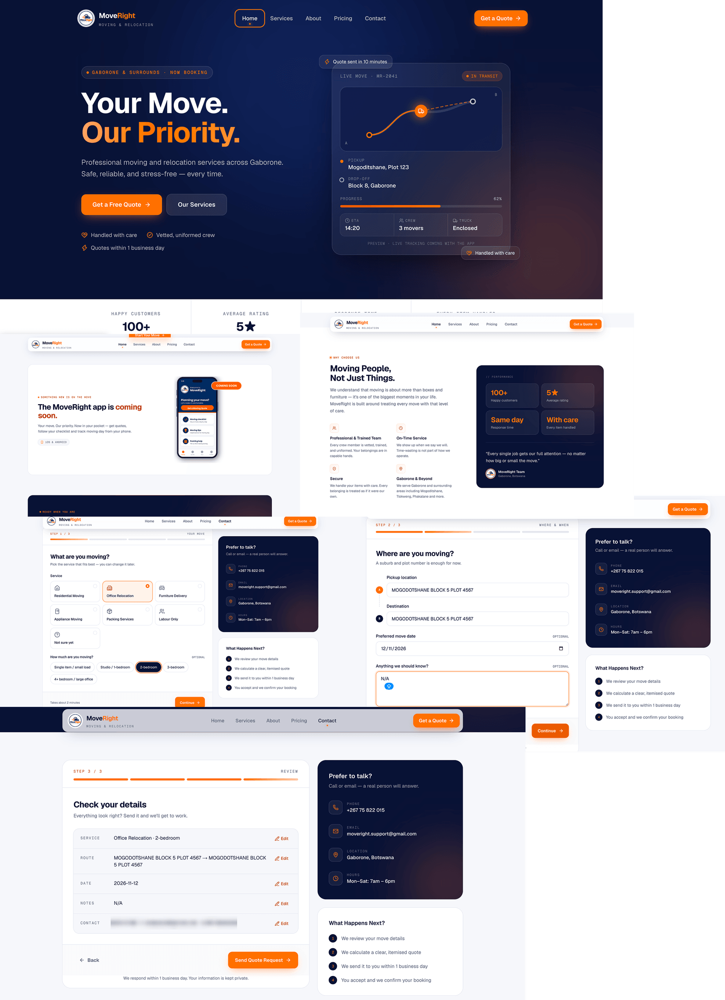
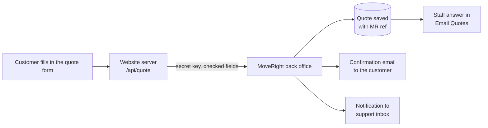

<div align="center">


# MoveRight

**Moving & relocation in Gaborone, Botswana. Your Move. Our Priority.**

[Live site](https://customer-web-alpha-eosin.vercel.app) · [Get a quote](https://customer-web-alpha-eosin.vercel.app/contact) · +267 75 822 015 · moveright.support@gmail.com

<br />



</div>

---

## What this is

The customer website for **MoveRight**, a moving company serving Gaborone and the surrounding areas (Mogoditshane, Tlokweng, Phakalane, Block 8 and more). Visitors can see the services and starting prices, then request a quote in three short steps. Every request goes straight to the MoveRight team, and the customer gets a confirmation email.

## Features

- **Five pages**: Home, Services, Pricing, About and Contact, all built for phones first.
- **Three-step quote form**: pick a service and size, enter pickup and destination, add contact details, then review everything before sending. Friendly inline messages guide people who are new to online forms.
- **Quotes reach the team**: each request gets a reference such as `MR-0042`, is stored in the MoveRight back office, and triggers a confirmation email to the customer from the support address. Staff reply by email from the back office.
- **Accessible**: readable contrast, works with a keyboard and screen readers, and respects the "reduce motion" setting.
- **Spam protection**: a hidden trap field and a per-visitor limit on quote requests.

## How a quote travels



The website never exposes the back office or its key to the browser: the form posts to the website's own `/api/quote`, which checks the details and forwards them. The back office (a separate, private repository) stores the quote and sends the emails.

## Tech stack

| | |
|---|---|
| Framework | [Next.js 16](https://nextjs.org) (App Router, Cache Components) |
| UI | React 19, TypeScript, [Tailwind CSS v4](https://tailwindcss.com), [lucide](https://lucide.dev) icons, Geist fonts |
| Hosting | [Vercel](https://vercel.com) |
| Back office | Node.js + Express + MongoDB (private repository) |

## Project structure

```
customer-web/
├── app/
│   ├── page.tsx              Home
│   ├── services/ pricing/ about/ contact/
│   ├── api/quote/route.ts    Receives the quote form and forwards it to the back office
│   ├── layout.tsx            Fonts, navbar, footer, page metadata
│   └── globals.css           Colours, fonts and shared styles
├── components/
│   ├── quote/QuoteWizard.tsx The three-step quote form
│   ├── ui/                   Button, PageHero, SectionHeader, IconBadge
│   └── Navbar, Footer, CtaBand, RouteTracker, ServiceCard
├── lib/site.ts               Services, contact details, menu links (edit content here)
└── public/                   Logo, banner and app images
```

## Run it on your computer

You need Node.js 20.9 or newer.

```bash
cd customer-web
npm install
cp .env.example .env.local   # then fill in the two values below
npm run dev                  # http://localhost:3000
```

| Variable | What it is |
|---|---|
| `QUOTES_API_URL` | Address of the MoveRight back office, e.g. `http://localhost:5000` locally |
| `WEBSITE_API_KEY` | Shared secret; must match the back office's `WEBSITE_API_KEY`. Server-only, never prefix it with `NEXT_PUBLIC_` |

Without these, the site still runs; only sending a quote shows a "temporarily unavailable" message.

Other commands: `npm run build` (production build) and `npm run lint`.

## Deploying

The site is deployed on **Vercel** from this repository:

1. Import the repository in Vercel and set **Root Directory** to `customer-web`.
2. Add `QUOTES_API_URL` and `WEBSITE_API_KEY` under *Environment Variables*.
3. Every push to `main` redeploys automatically. After changing a variable, redeploy for it to take effect.

**If quotes stop arriving:** open Vercel → *Logs* and search for `[quote]`. Each request writes a few lines showing where it stopped (missing settings, the back office refusing the key, or the back office being unreachable). The lines never include the key or customer details.

## Editing content

- **Services, contact details and menu**: `customer-web/lib/site.ts`
- **Prices and FAQs**: `customer-web/app/pricing/page.tsx`
- **Colours and fonts**: `customer-web/app/globals.css` (brand navy `#1B2B6B`, orange `#F47920`)

---

<div align="center">

© 2026 MoveRight Moving & Relocation Services · Gaborone, Botswana

</div>
